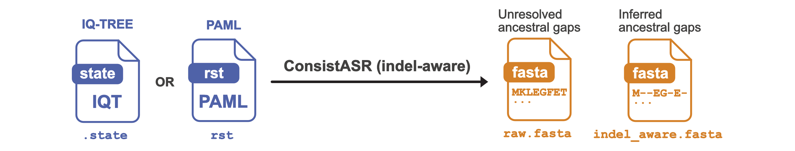
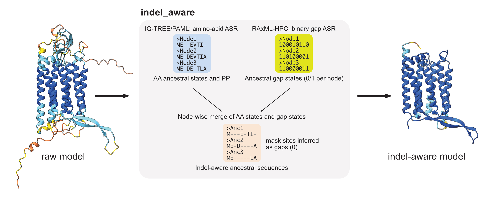
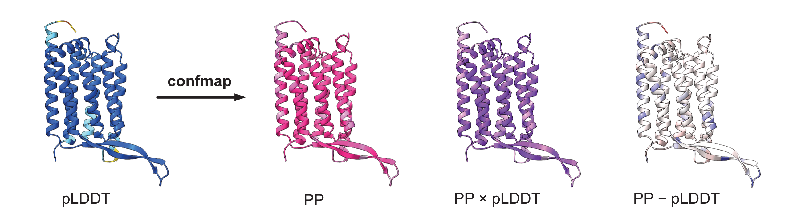

# ConsistASR

[](https://doi.org/10.5281/zenodo.18080327)

ConsistASR is a collection of small, modular scripts for **indel-aware ancestral sequence reconstruction (ASR)** and **confidence mapping** on AlphaFold models.

The included examples focus on full-length 7-transmembrane (7TM) microbial rhodopsins, including heliorhodopsins and schizorhodopsins, but the workflow is applicable to other sufficiently alignable protein families containing lineage-dependent insertions and deletions.

---
## What ConsistASR does

ConsistASR provides tools to:

- extract **raw ancestral protein sequences** as FASTA files from **IQ-TREE `.state`** and **PAML `rst`** outputs
- generate **indel-aware ancestral FASTA files** from either IQ-TREE or PAML amino-acid ASR outputs using a common binary gap-state reconstruction framework
- report site-wise posterior probabilities for ancestral residue presence/absence and amino-acid states
- map **ASR posterior probability (PP), AlphaFold pLDDT, PP × pLDDT, and PP − pLDDT onto AlphaFold models** via B-factors
- sanitize FASTA headers before using PHYLIP/RAxML/PAML-style workflows
- pre-filter and cluster large sequence datasets before tree building
- perform ESR proxy validation for checking whether known extant sequences can be reconstructed from phylogenetic context



---
## Indel-aware ASR workflow

ConsistASR includes two indel-aware ASR workflows:

- `iqtree_pipeline/indel_aware/` for IQ-TREE `.state` outputs
- `raxml_paml_pipeline/indel_aware/` for PAML `rst` outputs



Both workflows use the same RAxML-NG-based binary gap-state reconstruction, allowing the effect of the amino-acid ASR backend to be compared under a common indel-aware processing framework.

---
## Confidence mapping workflow

The `confmap` scripts map ASR posterior probability and AlphaFold confidence metrics onto PDB B-factors for visualization in PyMOL, ChimeraX, or related tools.



---
## Installation (quick)

Quick installation using the provided conda environment:

```bash
conda config --set channel_priority strict
mamba env create -f environment.yml   # or: conda env create -f environment.yml
conda activate ConsistASR
```
Strict channel priority is recommended to reduce unintended mixing of packages from different channels.

For detailed installation, pipeline descriptions, and examples, please see the main documentation:

👉 [`ConsistASR/README.md`](ConsistASR/README.md)

The supplied `environment.yml` defines the reference environment used to test the workflows described in the documentation. Treemmer is required only for the optional tree-based preclustering utility and should be installed separately when that function is used.

---
## What's new since v1.0.1

Compared with v1.0.1, ConsistASR v1.2.0 includes:

- raw ASR FASTA extraction from IQ-TREE `.state` and PAML `rst` outputs
- indel-aware processing of both IQ-TREE and PAML ancestral reconstructions using a common binary gap-state framework
- binary gap-state reconstruction with RAxML-NG `--evaluate` and `--ancestral`
- site-wise posterior-probability outputs for binary presence/absence states and final integrated ancestral sequences
- improved validation of node correspondence, alignment coordinates, binary-state inputs, and PAML root handling
- confidence mapping of ASR posterior probabilities and AlphaFold pLDDT onto predicted structures
- UniProt-style FASTA header renaming, preclustering/filtering, and ESR proxy-validation utilities
- updated toy examples, expected outputs, and reproducibility checks

---
## Background reference

The binary gap-state reconstruction strategy used in the indel-aware workflow follows the general idea described in:

- Aadland, K., Pugh, C. and Kolaczkowski, B. High-Throughput Reconstruction of Ancestral Protein Sequence, Structure, and Molecular Function. *Methods Mol. Biol.* 1851, 135–170, (2019). https://doi.org/10.1007/978-1-4939-8736-8_8

---
## Citation

If you use ConsistASR in your work, please cite the associated paper:

- Ishikawa, H. and Mizutani, Y. Resurrecting Full-Length Ancestral Schizorhodopsins and Heliorhodopsins with Structure-Guided, Indel-Aware Sequence Reconstruction. *ACS Omega* 11, 35989–36007, (2026). https://doi.org/10.1021/acsomega.6c03010

Please also cite the software archive. For the latest version, use the Zenodo concept DOI:

- ConsistASR. Zenodo. https://doi.org/10.5281/zenodo.18080327

For an exact release, please cite the version-specific DOI listed on Zenodo for that release.

---